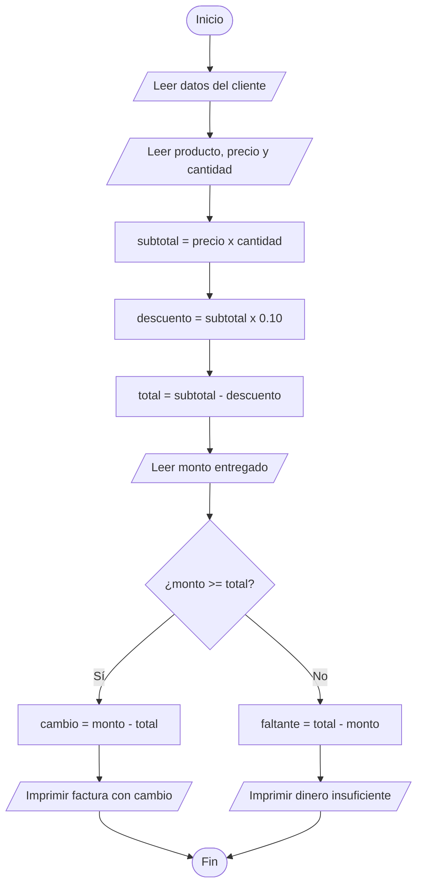

<a name="inicio"></a>

<div align="center">


# 🕷️ COMPRA DE PRODUCTO · LA RED DEL VECINDARIO 🕸️


</div>

<p align="center">
  <strong>🕸️ CUARTEL GENERAL DEL CÓDIGO · FACULTAD DE INGENIERÍA EN SISTEMAS, ELECTRÓNICA E INDUSTRIAL</strong><br>
  <em>«Con un gran poder de cálculo viene una gran responsabilidad: no equivocarse en el cambio del cliente.»</em>
</p>

<div align="center">


<br>


<br><br>

**Bienvenido a la red, vecino.**<br>
Este repositorio contiene el programa **`compraProducto.java`**, que registra los datos de un cliente y de un producto, calcula la compra con un descuento del 10% y emite una **factura de venta** con el cambio o el dinero faltante.<br>
Como todo buen trepamuros, el programa sigue tres movimientos: **entrada, proceso y salida**.

**Un héroe. Un programa. Cero errores de compilación.**

[🗽 Expediente](#expediente) ·
[🕷️ Héroe](#heroe) ·
[🕸️ Poderes](#poderes) ·
[🧪 Laboratorio](#laboratorio) ·
[📸 Prueba](#prueba) ·
[▶️ Cómo ejecutar](#como-ejecutar) ·
[🍕 Descanso](#descanso)

</div>

---

<a name="expediente"></a>

## 🗽 El expediente · ¿De qué trata este repositorio?

Una tienda del vecindario necesita emitir facturas rápidas, y el sentido arácnido no basta para hacer cuentas. Este programa en **Java** resuelve el problema: pide los datos por teclado con `Scanner`, hace los cálculos y muestra una factura ordenada en consola.

<div align="center">

</div>

### 🎯 Objetivos de la misión

- **Capturar datos**: leer el nombre, la cédula y el teléfono del cliente, junto con el producto, su precio y la cantidad.
- **Calcular la compra**: obtener el subtotal, el descuento del 10% y el total a pagar.
- **Comparar el pago**: decidir con un `if-else` si hay cambio o si falta dinero.
- **Imprimir la factura**: mostrar los resultados con formato de 2 decimales usando `printf`.

> [!TIP]
> **Lema del vecindario:** «Después de un `nextInt()` o `nextDouble()`, limpia el buffer con `nextLine()`… o la red se enreda».

---

<a name="heroe"></a>

## 🕷️ El héroe · Integrante y rol

Esta misión se resuelve en solitario. El único integrante se balancea por todo el código:

<div align="center">

</div>

| N.º | Integrante | Rol en la red | Componentes |
| :---: | :--- | :--- | :--- |
| **1** | **PAREDES ACOSTA DERECK SHAIR** | **Trepamuros del Código · Analizar, programar y probar** | Programa `compraProducto.java` con su prueba de escritorio. |

| Dato | Detalle |
| :--- | :--- |
| **Asignatura** | Algoritmos y Lógica de Programación |
| **Nivel y paralelo** | Primero - B |
| **Docente** | Ing. José Ruben Caizabuano, M.Sc. |
| **Universidad** | Universidad Técnica de Ambato |

---

<a name="poderes"></a>

## 🕸️ Los poderes · Variables del programa

Cada variable es un lanzarredes con una tarea concreta:

| Poder | Variable | Tipo | ¿Para qué sirve? |
| :---: | :--- | :---: | :--- |
| 🕷️ | `nombreCliente` | `String` | Nombre de quien compra |
| 🕷️ | `cedulaCliente` | `String` | Cédula del cliente |
| 🕷️ | `telefonoCliente` | `String` | Teléfono del cliente |
| 🕸️ | `nombreProducto` | `String` | Producto que se compra |
| 🕸️ | `precioUnitario` | `double` | Precio de una unidad |
| 🕸️ | `cantidad` | `int` | Número de unidades |
| 🧪 | `subtotal` | `double` | `precioUnitario * cantidad` |
| 🧪 | `descuento` | `double` | `subtotal * 0.10` |
| 🧪 | `total` | `double` | `subtotal - descuento` |
| 💵 | `montoEntregado` | `double` | Dinero que entrega el cliente |
| 💵 | `cambio` | `double` | `montoEntregado - total` |
| 💵 | `faltante` | `double` | `total - montoEntregado` |

---

<a name="laboratorio"></a>

## 🧪 El laboratorio · ¿Cómo funciona?

### 🕷️ Primer balanceo · Entrada de datos

El programa usa un `Scanner` llamado `deri` para leer por teclado los datos del cliente (nombre, cédula y teléfono) y del producto (nombre, precio unitario y cantidad). Luego descarta con `deri.nextLine()` el salto de línea que queda pendiente tras leer números.

### 🕸️ Segundo balanceo · Proceso

```java
subtotal  = precioUnitario * cantidad; // precio por cantidad
descuento = subtotal * 0.10;           // 10% del subtotal
total     = subtotal - descuento;      // lo que se paga
```

### 🗽 Tercer balanceo · Salida y decisión

Se pide el monto entregado y se imprime la factura. Al final, una estructura condicional decide el destino del vecindario:

```java
if (montoEntregado >= total) {
    cambio = montoEntregado - total;   // se devuelve el cambio
} else {
    faltante = total - montoEntregado; // se informa cuánto falta
}
```

### 🔁 Diagrama de flujo de la misión



---

<a name="prueba"></a>

## 📸 La foto del Daily Bugle · Prueba de escritorio

**Caso 1 · El cliente paga de más (hay cambio)**

```text
Nombre del cliente: Dereck Paredes
Cedula del cliente: 1800000000
Telefono del cliente: 0990000000
Nombre del producto: Cuaderno
Precio unitario del producto: 2.50
Cantidad de unidades: 4

Monto entregado por el cliente: $10

================================
         FACTURA DE VENTA
================================
Cliente:  Dereck Paredes
Cedula:   1800000000
Telefono: 0990000000
--------------------------------
Producto: Cuaderno
Precio unitario: $2.50
Cantidad: 4
--------------------------------
Subtotal:          $10.00
Descuento (10%):   $1.00
Total a pagar:     $9.00
--------------------------------
Monto entregado:   $10.00
Cambio:            $1.00
================================
```

**Caso 2 · El cliente no completa el pago**

```text
Subtotal:          $10.00
Descuento (10%):   $1.00
Total a pagar:     $9.00
--------------------------------
Monto entregado:   $5.00
Dinero insuficiente. Falta: $4.00
================================
```

| Variable | Caso 1 | Caso 2 |
| :--- | :---: | :---: |
| `precioUnitario` | 2.50 | 2.50 |
| `cantidad` | 4 | 4 |
| `subtotal` | 10.00 | 10.00 |
| `descuento` | 1.00 | 1.00 |
| `total` | 9.00 | 9.00 |
| `montoEntregado` | 10.00 | 5.00 |
| `cambio` / `faltante` | **cambio = 1.00** | **faltante = 4.00** |

---

## 🗂️ La guarida · Estructura del repositorio

```text
compraProducto/
┣ 📜 compraProducto.java
┗ 📜 README.md
```

---

<a name="como-ejecutar"></a>

## ▶️ Cómo ejecutar · Lanza la red

```bash
javac compraProducto.java
java compraProducto
```

> [!IMPORTANT]
> - Escribe los decimales según la configuración regional de tu equipo: en algunos sistemas `Scanner` espera **coma** (`2,50`) en lugar de **punto** (`2.50`).
> - El nombre del archivo debe coincidir con el de la clase: **`compraProducto.java`**.

---

<a name="descanso"></a>

## 🍕 Zona de descanso · Una pausa en Queens

<div align="center">

*«Misión cumplida, vecino. La factura salió perfecta y el cambio fue exacto. Ahora sí, a por una pizza.»*

Si llegaste hasta aquí, la red te agradece la visita. 🕷️🕸️❤️💙

[⬆️ Volver al inicio](#inicio)


</div>
